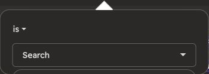

# Chrome QA: 0.3.3

Inspected the already-installed extension in the user's local Chrome on 2026-11-03.
The installed pages showed the 0.3.2 ad-frame fix after a page refresh. These browser
observations are separate from verification of the new 0.3.3 code.

| Area | Browser observation | Change in 0.3.3 |
| --- | --- | --- |
| LinkedIn notifications | Embedded ad switches to dark after refresh; some unselected filter labels remain black | Early label fallback; watch late page styles and CSSOM rule additions |
| LinkedIn profile | Warm surfaces and photos preserved; some interface icons and outlines remain dark | Monochrome UI glyph fallback and late-style rescanning |
| LinkedIn full messaging | Message surfaces are dark; image, attachment, GIF and emoji controls are black | Extend readable icon fills to enabled messaging actions |
| LinkedIn messaging overlay | Header controls and close icon appear white | Existing behavior retained |
| HubSpot deal table | Settled rows and expanded CRM navigation are dark and readable | Existing table and sidebar coverage retained |
| HubSpot date-filter popover | Pointer remains white over a dark popover | Target only the identified popover SVG; match fill and border to the surface |
| HubSpot deal record | Cards, tabs, association panels and loading surfaces are dark | No record data changes |
| HubSpot pipeline board | Loaded board is dark, but initial loading shimmer is bright white | Fix scoping of pseudo-elements; early warm-gray shimmer fallback |

No messages were sent or CRM records edited. The temporary notification filter
and pipeline view were restored. No account or customer content is included here.

## Evidence from the installed copy

These are cropped before-fix captures, not proof of 0.3.3 rendering.

## Validation and remaining step

36 automated tests pass, including new checks for late CSS-in-JS styles,
page stylesheet changes, hydration-marker repair, observer-loop prevention,
and pseudo-element selector scoping. Manifest and packaging checks pass.

The browser connection cannot claim Chrome's internal extension-manager tab.
The installed unpacked extension must be updated/reloaded before the 0.3.3
fixes can be visually retested. Manual System/Dark/Light popup switching and
OS appearance switching were not completed in this browser pass. The existing
mode-propagation tests pass. No claim of complete site coverage is made.
