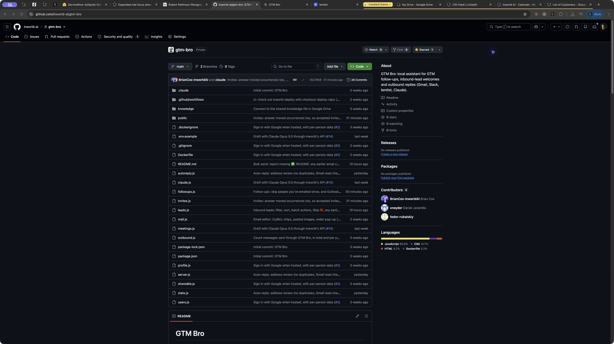

# Installed-extension audit and Light-mode fixes

Date: November 3, 2026. Chrome Inworld profile. Inspected the installed 0.4.0
version; the resulting source fixes are packaged as 0.4.1.

## Live observations

- Opened Drive, Docs, Sheets, Calendar, HubSpot and LinkedIn with the installed
  theme. Drive and Docs rendered warm gray backgrounds and readable content.
  Calendar week and Sheets grid were also visually inspected in System/Dark.
- Used the installed popup to select Light. Docs and Sheets removed their canvas
  filters. Fresh LinkedIn removed its generated stylesheet and all theme markers.
  Drive and Calendar restored their own native appearance, which remained dark
  because their own settings follow the dark OS.
- Two pinned tabs still reported System/Dark after the popup had changed to
  Light. They retained stale scripts from before the extension update. Checked
  that the LinkedIn tab had no nonempty draft editors and that HubSpot showed
  its normal record view, then refreshed each once. Both subsequently reported
  Light with zero generated theme sheets and zero markers. No records, file
  contents, messages or calendar events were edited.
- Navigated Drive Home to My Drive and Calendar week to month. Opened Docs' File
  menu. Scrolled LinkedIn's main container to 1,361 CSS pixels in Light: zero
  generated theme sheets and zero theme markers remained.
- No captured error entries were attributed to the extension's source URL in
  the six inspected apps. HubSpot and Calendar had application errors in the
  captured log window; they were not attributed to extension code.
- Restored the original System setting using the popup. A fresh Calendar tab
  confirmed `mode=system` and `theme=dark`; its week view was visually checked.
  The screenshot below contains only the extension popup, with no customer data.

## Fixes

The old controller called `stop()` whenever a light tab resumed, even when no
engine had started. HubSpot's stop routine unconditionally queried the document
for cleanup markers. On a dark OS, the controller could also start an engine
before a saved Light override arrived from storage.

0.4.1 waits for a known preference before starting an engine, invokes start/stop
only on transitions, and refreshes only a running engine. Manual overrides detach
the OS-change listener; System retains it. Both engines have an idempotent stop.
HubSpot clears generated-CSS caches and retained stylesheet references on stop.

The Sheets visual check found a white background behind the formula icon. Its
actual ancestors are `#formula-bar` and `#formula-bar-name-box-wrapper`; both now
receive the dark input surface, along with `#formula-bar-container`.

## Automated verification

Tests cover 1,000 repeated resume/page-show events in System/Light and manual
Light, a saved Light override arriving slowly on a dark OS, one start/stop per
actual transition, and no repeated inactive engine DOM queries or color reads.
HubSpot and LinkedIn checks verify that stop removes observers, intervals and
queued frame/delay work. Restarting after Light still works.

These are operation/resource assertions in deterministic harnesses, not live
Chrome timing measurements. The 0.4.1 source changes still require an extension
reload and page refresh before their applied behavior can be checked in Chrome.

## Latency limits

No enabled-versus-disabled performance trace was captured. A saved browser
permission denied raw DevTools access in previous attempts and was not bypassed.
Some browser-control commands timed out or lost their debugger connection during
the session. Those tool round-trip times are not page-load or extension latency.

Light mode can be free of recurring theme-engine work while still having small
startup costs: Chrome loads/parses the content scripts and CSS, and the controller
keeps the appearance/storage listeners needed to react to a mode change. No claim
of literally zero computer-wide CPU/memory cost, zero added milliseconds, or a
verified 100–200 ms navigation budget is justified by these checks.
